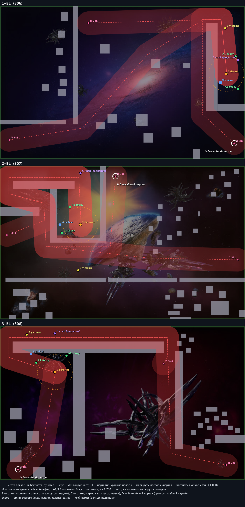
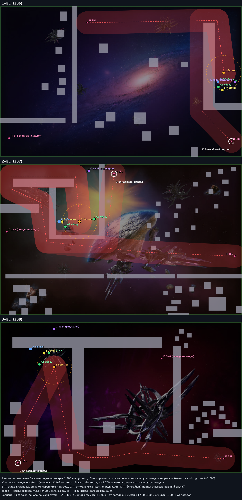
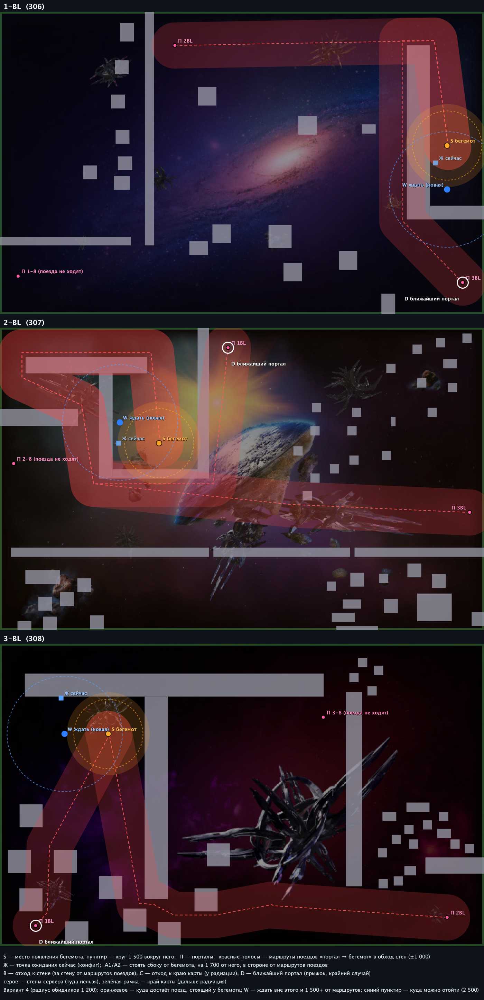
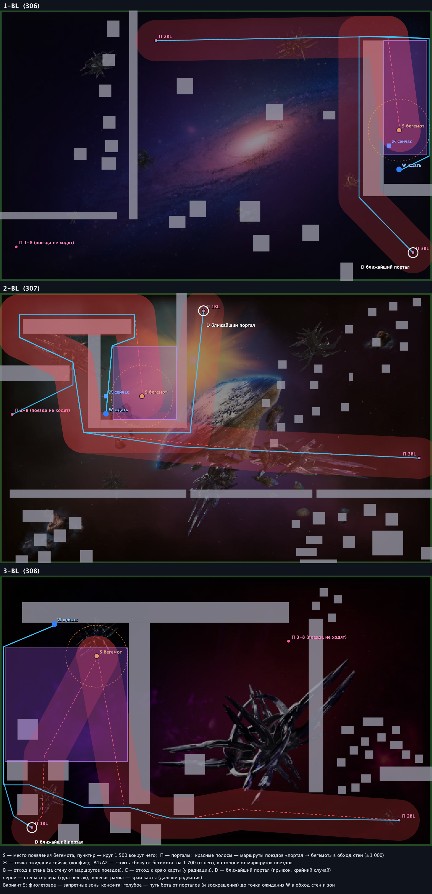

# Blacklight: фарм NPC, инвоки, бегемоты, бой за спот

Описание, как делаем (пользователь, 2026-11-12). Всё настраивается конфигом. Делаем по этапам: A → B → C, потом D и E.

## Что известно

- **Карты.** 1-BL (306), 2-BL (307), 3-BL (308). Вход:
  - с x-8 через портал в центре (110/110);
  - между BL-картами — через порталы по углам.

  Своя BL открыта с 17 уровня, чужие — с 24 (`Router.open`). У аккаунта 1 (ru1, EIC) это 2-BL.
- **NPC на всех трёх картах** (`reference/maps/npc-maps.json`). Имена на BL — в форме `\\ Имя //`:

  | NPC | HP | Как бить | Радиус DarkBot |
  |---|---|---|---|
  | Impulse II | 1,2 млн | лёгкий, в одиночку | 560–680 |
  | Attend IX | 9 млн | пользователь: бить в одиночку | 560–620 |
  | Invoke XVI | групповой | награда только топ-5 по урону | 720 |
  | Mindfire Behemoth | групповой | — | 800 |
  | Purpose XXI | — | на 3-8 | — |

- **Профили пользователя в DarkBot** (сборка GE5):
  - `BL_RINUSK`: только Impulse II, патроны x1 (LCB-10), ремонт при 35–45%, без бегства, питомец выключен;
  - `BL_INVOKE`: Invoke XVI с приоритетом −100 и флагами `IGNORE_OWNERSHIP`, `IGNORE_ATTACKED`, `ATTACK_SECOND`, `PET_LOCATOR`; пока инвока нет — Impulse II; сбор `SOLAR_CLASH` и `UNSTABLE_BLACKLIGHT_CACHE`; `ONLY_KILL_PREFERRED = false`, чтобы находить споты инвока по всей карте.
- **Что уже есть у нас и пригодится:**
  - `KILL_COLLECT` + таблица NPC с флагами владения;
  - `Attacker` (погоня, кружение, упреждение);
  - пеленгатор питомца по номеру NPC — для инвоков обязателен;
  - `SpawnMemory` (споны и время возврата Cubikon) — та же задача, что точки бегемотов;
  - `CubikonModule` (ждать на спавне, лететь к следующему);
  - `GroupWatch` (приглашения, лидер);
  - `Offenders` (кто стрелял — обходить);
  - `Flee`, `SafePlaces`.

## Факты из сети (2026-11-12)

Уверенность — в скобках. Источники:
- darkorbitwiki.com (?p=978 Invoke, ?p=981 Behemoth, /p-e-t/);
- Blacklight FAQ на board-en (threads/blacklight-faq.123290);
- испанский гайд DarkBot (darkbotes.gitbook.io, black-light);
- эмулятор OpenOrbit (github.com/kaanumay/OpenOrbit, `server/data/npc.json`, `map_layout.json`): он опирается на форум board-fr 127829 и на свою запись 2-BL.

Где они расходятся с наблюдением пользователя, проверяем вживую.

- **Invoke XVI:**
  - 36 млн HP, щита нет, урон 30 000;
  - **не двигается**; бьёт первого, кто вошёл в его радиус, а не того, кто больше бьёт; сбрасывает цель, когда тот отлетел (высокая);
  - на каждые сколько-то снятых HP выпускает 8 Impulse II (высокая);
  - x8 урона по нему — патроны A-BL (высокая);
  - **3 на карту, в одной области** (средняя):
    - 1-BL — прямоугольник слева;
    - 2-BL — прямоугольник внизу;
    - 3-BL — справа.
    - Примерные точки OpenOrbit (низкая–средняя):
      - 1-BL: 2000/2550, 2600/5000, 1700/8100;
      - 2-BL: 6250/11650, 9000/11750, 11700/11650;
      - 3-BL: 17800/3500, 19300/4700, 17800/5650.

    FAQ пишет «места фиксированные», пользователь — «случайно в области». Бот всё равно учит места сам, а находит пеленгатором.
  - возрождение около 15 мин (низкая–средняя);
  - награда — топ-5 по урону (высокая).
- **Пеленгатор (G-EL):**
  - дальность 2000 / 3000 / 5000 (уровни 1–3), до 5900 у 3X (высокая);
  - даёт место отметки, а не направление; отметки приходят примерно раз в 0,5 с;
  - список NPC для пеленгатора — из подменю режима питомца в игре, номер берётся оттуда.
- **Номера NPC** (средняя, OpenOrbit):
  - Impulse II — 175;
  - Attend IX — 176;
  - **Invoke XVI — 177**: закрывает пункт плана «NPC 177, квест 117079»;
  - Mindfire Behemoth — 178 (совпадает с нашим `npcs.json`).

  175–177 в нашем `npcs.json` нет. Проверить по подменю пеленгатора вживую.
- **Impulse II:** 1,2 млн HP, щит 750 тыс., урон 12 000, скорость 450, 15–25 ринуска (высокая).
- **Attend IX:** 9 млн HP, щит 4,8 млн, урон 17 000, скорость 150, 80–90 ринуска и 5–15 Blacklight Trace (высокая). Бой долгий — проверить, что бот не бросает его раньше времени.
- **Mindfire Behemoth:**
  - 135 млн HP, урон 145 000;
  - **самая большая дальность атаки в игре**;
  - ударная волна бьёт тех, кто подошёл близко, и лечит его; снимает маскировку; замедляет;
  - при малом HP бьёт нескольких;
  - награда — топ-8 по урону (высокая);
  - один на карту, около 15 мин (средняя). Точки OpenOrbit (низкая–средняя):
    - 1-BL: 19900/4400;
    - 2-BL: 6700/4100, в огороженном квадрате;
    - 3-BL: 3500/4700.
- **Ящики:**
  - Unstable Cache стоит на каждой BL-карте, открывается Blacklight Cipher, даёт дизайн Centurion (высокая). Бот без ключа его не откроет — по умолчанию **не собирать**, решает пользователь;
  - что даёт `SOLAR_CLASH`, не нашлось. Настоящие названия ящиков инвока и бегемота тоже неизвестны — смотреть вживую.
- **Не нашлось:** готовые профили DarkBot для инвоков, советы против групп, которые стреляют подлетающих, сколько игроков нужно на бегемота.

## Этап A. Фарм Impulse II и Attend IX

Отдельный модуль не нужен: это `KILL_COLLECT` на BL-карте плюс то, чего там пока нет.

1. **Шаблон конфига `BL_FARM`** (создаётся из окна конфигов, как QUESTS):
   - рабочая карта — своя BL;
   - бить: Impulse II и Attend IX, у каждого галочка;
   - радиусы — по таблице DarkBot;
   - патроны — по выбору: x1 для ринуска или урон;
   - сбор: `SOLAR_CLASH`, `UNSTABLE_BLACKLIGHT_CACHE`;
   - ремонт при 35–45%.
2. **Вражеские боевые станции кланов** (`ASSETTYPE_BATTLESTATION` 36) стреляют. Нужно держаться дальше их радиуса и не брать цели и ящики под ними. Настройка «Обходить чужие станции, радиус». Свои и станции своего клана не обходить.
3. **Каталог ящиков:** добавить `UNSTABLE_BLACKLIGHT_CACHE`, проверить, как его называет сервер.
4. **Attend IX:**
   - 9 млн HP — бой долгий;
   - нужно продумать: кружение, ракеты, ремонт посреди боя (вернуться к той же цели, если её не забрали) и «не своя цель» по обычным правилам;
   - ограничение по времени боя есть («не теряет HP N с — бросаю»).
5. **Безопасность на BL:** здесь много игроков всех компаний.
   - Настройки бегства и «обходить тех, кто стрелял» уже есть.
   - Ремонт — у портала: на BL-картах нет баз.
   - Проверить, что безопасное место — портал на x-8.

Проверка: аккаунт 1 на 2-BL.

## Этап B. Модуль INVOKE: охота на Invoke XVI

Точек появления у инвока нет. Он появляется в случайном месте внутри области карты (пользователь, 2026-11-12). Поэтому найти его можно только **пеленгатором питомца**: без него модуль не запускается. Перед стартом проверка конфига и живая проверка: у питомца нет режима «Пеленгатор врагов» → стоп с понятной причиной.

- **Область.**
  - Бот запоминает, где видел инвоков: точки по картам, `local/invoke-areas.json`. По ним видно, в какой части карты их искать и где ждать.
  - Пользователь может подсказать область сам: зона «предпочтительно» в конфиге.
- **Таймер.**
  - Бот запоминает, через сколько после смерти появился следующий инвок на этой карте.
  - Это не время возврата в ту же точку, как у кубов, а время до следующего инвока на карте.
- **Цикл:**
  1. Пеленгатор (номер NPC инвока) даёт направление и место.
  2. Лететь туда.
  3. Оценить, кто у инвока (этап C).
  4. Бить: не своя цель — можно, урон максимальный, держаться в радиусе.
  5. Собрать ящик.
  6. Ждать следующего: держаться в середине области, пеленгатор спрашивать по таймеру.
- **Пока ждём** (по желанию, одна настройка «Пока ждём: ничего / Impulse / Impulse и Attend»):
  - бить Impulse II или Attend IX внутри области;
  - бросать сразу, как пеленгатор нашёл инвока.
  - Попутно Impulse не уводит далеко: «не дальше N от середины области».
- **Когда вступать в бой** (пользователь: не в одиночку):
  - «рядом не меньше K других кораблей»;
  - «у инвока уже снято не меньше X% HP»;
  - «можно в одиночку»: да / нет.
- **Карты:** одна или несколько BL. Если на этой карте до следующего инвока долго, а на соседней он уже есть (пеленгатор там не достаёт — только по времени), можно перейти.

## Этап C. Бой у цели, когда группы стреляют подлетающих

Лагерь бывает двух видов, правила для них разные:
- **у инвока лагеря на месте нет:** инвок каждый раз в новом месте, и группы ходят за ним сами. «Лагерь» — это группа, которая сейчас бьёт этого инвока и стреляет тех, кто подлетает к нему;
- **у бегемота точка одна на карту:** группы держат саму точку и ждут его там. Это настоящий лагерь у спота, и стоит он долго.

Делаем в три шага. Каждый включается отдельно.

**C1. Видеть.** У каждой цели (инвок, бегемот) и у точки бегемота бот следит:
- кто стрелял по нам;
- кто стрелял по другим, когда те подлетали к цели (сервер шлёт выстрелы игроков по игрокам);
- кто из них в одной группе или клане.

Получается «кто держит цель»: кто, сколько их, урон в секунду. Группы, которые стреляют подлетающих, бот запоминает до конца работы, по тегу клана и составу группы: та же группа встретится у следующего инвока. В окне — карточка «Инвок: держит [TAG] ×5, стреляют подлетающих».

**C2. Решать, не воюя** («Если цель держат»):
- **инвок:**
  - пропустить этого и ждать следующего: он появится в другом месте, а группа, может, не успеет;
  - подлетать к концу боя: у инвока меньше X% HP, группа занята им;
  - бить с края радиуса;
- **бегемот:**
  - не стоять в их лагере;
  - ждать за пределами их досягаемости и подлетать, когда бегемот появился и они заняты им;
  - перейти на другую BL-карту, где точку не держат;
- **в обоих случаях:** не подлетать к группе, которая нас убила, N минут.

**C3. Своя группа — «паровоз».** Несколько аккаунтов пользователя (все в одной программе) работают вместе:
- **Сбор.** Лидер и ведомые задаются в конфиге модуля. `GroupWatch` уже умеет приглашать.
- **Строй.** Ведомые держатся рядом с лидером. Пеленгатор нужен только лидеру: группа летит за ним. Цель выбирает лидер, бьют все. Аккаунты договариваются внутри программы, без игрового чата.
- **Защита.** Если игрок бьёт любого из наших, его бьют все: настройка «Защищать группу».
- **Очистка** — только по включённой настройке:
  - у инвока группа первой атакует тех, кто стреляет подлетающих;
  - у бегемота — тех, кто держит точку;
  - условия: «нас не меньше, чем их», «их урон ниже нашего», «отступить, если HP группы ниже N%».
- **Что для этого нужно:**
  - выбор цели-игрока;
  - патроны и ракеты против игроков (отдельный набор в конфиге);
  - способности кораблей в бою с игроками.

C3 — большой этап. Его делаем, только когда C1 и C2 покажут, что без него не обойтись.

## Этап D. Модуль BEHEMOTH: Mindfire Behemoth

**Сделано соло, как модуль «Mindfire Behemoth» AstraBot (2026-11-13)** — `BehemothModule`, вкладка «Бегемот», модуль
«Бегемот» во «Общем». Источник настроек — раздел BEHEMOTH профиля `AstraBot - GE3/configs/behe.json` (только у этого
бота на VPS есть профиль бегемота); точки — из исходников BeheFarmBySpearhed; таймер 15 мин — BeheFarm/BLCycle.

- **Карты** (`maps`, у AstraBot firstMap…thirdMap): 1-BL, 2-BL, 3-BL. Бот запоминает, когда бегемот появился и погиб в
  его виду (`<данные аккаунта>/behemoth-spawns.json`, как споны кубов), и летит туда, где он будет раньше (перелёт ~90 с
  считается; карта без сведений — минута штрафа). Время возрождения бот узнаёт сам (до того 15 мин; `respawnMinutes`
  задаёт вручную).
- **Ожидание:** у точки рядом со спауном (BeheFarm: 1-BL 191/79, 2-BL 52/57, 3-BL 57/26; спауны 194/58, 69/50, 47/39);
  нет бегемота `changeMapSeconds` (30 с) после прилёта или после времени появления — другая карта. Пока ждём:
  `defenceMode` — отвечать NPC, которые стреляют по нам; `killOthers` — бить и остальных (по списку NPC).
- **Бой:** бегемот любого «хозяина» (урон засчитывается всем), по его строке в списке NPC (у AstraBot: радиус 590,
  приоритет -100, A-BL, Drill, Ignore Attacked, Ignore Boxes, HP Link, Use ISH, Use RSB). EMP-01 — при HP корабля ниже
  `empPercent` (35 %), ISH-01 — ниже `ishPercent` (60 %); лимиты расхода — общие («Расход» во «Убивать»).
- **После убийства:** ящик бегемота (`collectBox`; SOLAR_CLASH в «Сборе») в конфигурации `collectBoxConfig` (2) и
  формации `collectBoxFormation` (Veteran), ждём его до 5 с, собираем до 20 с; потом следующая карта по таймерам.
- **Проверить вживую** (на аккаунтах с VPS): точки ожидания и спауна, время возрождения, имя ящика, порог EMP — чей HP
  у AstraBot `empPercent` (принято: корабля).

**Добавлено из AstraBot (2026-11-13; что делают — по названию, код закрыт):**
- `petOnlyOnBehemoth` — питомец убран (запрос «убрать»), пока бегемота нет в виду; появился — выпускается;
- `usePetCombatBeacon` и PET `useHpLink` / `hpLinkMinPercent` (65): в бою HP Link (флаг строки), пока HP корабля ниже
  65 %, иначе «Боевой маяк» (режим питомца 18);
- `usePrismatic` / `prismaticPercent` (50): призматический щит — `ability_spectrum`, `ability_spectrum-plus_prismatic-
  reflecting`, `ability_citadel-plus_prismatic-endurance` (что есть у корабля), при HP корабля ниже порога;
- `useSpearheadJamx` / `jamxDistance` (750): JAM-X (`ability_spearhead_jam-x`, `ability_spearhead-plus_jamx-creed`) по
  бегемоту ближе дистанции (как BeheFarm — вместе с EMP);
- флаги NPC `USE_LEECH` («Use Energy Leech»: `tech_energy-leech`) и `USE_ABILITY` («Use Ship Ability»: первая готовая
  боевая способность корабля из списка `Attacker.FIGHT_ABILITIES` — Venom, Diminisher, Sentinel, Spectrum, Solace,
  Aegis, Tartarus, Hecate, Retiarus, Solaris, Zephyr, Berserker, Citadel Fortify и др.; без перелётных, маскировки,
  миникарты, Draw Fire). Работают для любого NPC, не только бегемота. Названия — из полосы предметов, что шлёт сервер.

**Не сделано из настроек AstraBot:** `spearheadMode`, `useNovaOnce` (что это — не ясно), `useDrawFire` (Citadel: тянет
огонь на себя — для группы), `attackRandom`,
`chaseEnemy` / `chaseDistance`, `useRoamConfigOnLowHp`, `changeMapAfterDeath`, `useInfectionMine`, `buyCloak`,
`ignoreDisruptor`, `waitSecondsAfterJump`, `BLACKLIST`, `readMapInfo` / `channelID`.

### Группа и чужие поезда у бегемота — анализ (2026-11-13)

**AstraBot** (профили бегемота GE3 `behe.json`, старые `behehe.json`; логи 2026-10-23…27): группа — это модуль бегемота
с `followLeader` + `leaderId` (идти за игроком-лидером, `followSpeed`), приглашения — раздел INIVITATION (принимать от
списка / от всех). Враги: `defenceMode` (отвечать), `chaseEnemy` + `chaseDistance` 1500 (гнаться за врагами),
`killOthers`, `BLACKLIST`, `attackRandom`; способности для группы — `useDrawFire`, `shipAbilityForGroupMembers`.
Отдельный модуль охоты на игроков SHIP_KILLER (`maxKillPerPlayer`, `strictFollow`, `onlyBlacklist`). В логах соло-бегемота
AstraBot часто убивают игроки (один — 26 и 29 раз за сессию), он постоянно покупает маскировку, ставит инфекционную
мину, жжёт пиявку и точный прицел.

**CARNAGE** (7 профилей бегемота, 5 разных модулей; код закрыт/обфусцирован — видны настройки и лог):
- BLCycle (`BeheSolo`) — фарм среди поездов: `behemothPolicy = IGNORE_ATTACKED_USE_COUNT` (от атак не уходить, считать
  врагов; порог 0 — никогда), `avoidEnemyOrbit` (не вставать в кольцо чужих), прилёт ровно к появлению, маскировка
  при Heart, HP Link; AntiPush (4 смерти → пауза 5 мин). В логе 67+ бегемотов по ~5 700 уридия, побегов нет; зачёт —
  по пришедшему уридию > 5 000; невиденная карта — таймер сдвигается на круг (~14 мин); перелёт 70 / 130 с.
- devskoo BehemothModule (`BEHE-CLOAK`, `Berti…`): PVP_HELPER (бить врага первым / последним / после больших NPC,
  ENEMY_RADIUS 350), DEATH_COUNT (столько смертей — другая карта), CLEAR (чистить NPC), маскировка после смерти
  бегемота, маяк урона за 10 с до появления, PET_LINK_HP 0,6–0,65.
- orbithelper (`BEHE SPEARHEAD`): pvp (enemyRadius 500, attackRadius 1250, onlyRespond), deathCount 3, ожидание в
  предпочтительной зоне, маяк урона и Spearhead.
- leanon00 + PvpHelper (`Behe_Clear`): игроки ближе 500 — бить (дальше 1 000 — нет), RSB, без погони.
- Kekka FollowModule + DefenseMode (`Behemoth_CITA` — поезд Цитаделей): идти за лидером группы (STRICT_MODE), бить
  NPC и игроков; защита: отвечать атакующим, помогать своим (клан, союз, группа), идти к группе.

**Сделано допом (всё по галочкам, по умолчанию выключено — прежний фарм не меняется), вкладка «Бегемот»:**
- «Чужой поезд у бегемота» (`trainMode`): от их атак не уходим; `trainRadius` 1500 — кто считается поездом;
  `trainEnemyLimit` (0 — не уходить) — больше врагов → другая карта до следующего бегемота; `avoidEnemyOrbit` —
  стоять с другой стороны бегемота от чужих на своём радиусе и стрелять оттуда; `deathsPerSpawn` — погиб столько раз
  у бегемота → карту пропустить до следующего.
  Решает первый взгляд (1,5 с после того, как бегемот виден): начатый бой не бросается, даже если поезд прилетел.
  `trainEnemyLimit` по умолчанию 12; `trainAtLocator` (вкл.) — та же толпа у точки пеленгатора ещё до бегемота →
  карту пропустить; `leaveSkipped` (вкл.) — пропущенную карту покинуть сразу, к точке пеленгатора на ней не лететь;
  `empOnlyPlayers` (вкл., раздел «Бой») — ЭМИ только когда стреляет игрок. Кнопка «Поставить проверенные настройки»
  ставит всё проверенное (`BehemothProven`: 1500 / 12 / 4 смерти, вся тройка галочек, `avoidEnemyOrbit`,
  `learnSafeSpot`); проверка конфига перед запуском называет каждое отличие от проверенного.
- Сценарий CARNAGE (BeheSolo, разбор 2026-11-14): ждёт в предпочитаемой зоне конфига — одна клетка 75×75 на карту:
  1-BL 18620/6549, 2-BL 5180/4977, 3-BL 2660/2357 (1 100–2 560 от места появления); к бегемоту — по пеленгатору
  (флаг `PET_LOCATOR`), `IGNORE_ATTACKED`, радиус 500, RSB, HP Link; EMP и ISH — `EblExtraFlags` (флаг OFFENSIVE у
  бегемота: useEMP, useISH), навык — `CustomAbilities` по флагу NPC; возрождение в порту, ремонта нет. У нас:
  `waitInZone` + зоны 306–308 из BeheSolo, `abilityAtStart` (навык сразу у бегемота), `empThenIsh` (стреляет игрок —
  EMP, сразу за ним ISH, без порогов HP), `pushThrough` (на картах бегемота от поезда не уходить, в пути EMP, лететь к
  месту появления), `deathsPerSpawn` 1 (погиб — следующая карта); кнопка «Поставить как в CARNAGE». Запретную полосу
  1-BL из BeheSolo (x 17 640–18 760) не перенёс: в неё попадает их же точка ожидания.
- «Игроки» (`PlayerFight`, бой с игроком: выделить, патроны `pvpAmmo`, держать ~550): `respondPlayers` +
  `respondRadius` — отвечать стреляющим по нам; `defendGroup` — бить тех, кто бьёт нашу группу; `huntEnemies` +
  `huntRadius` — атаковать врагов рядом; `blacklist` — всегда; `enemyFocus` BEHEMOTH (игроки, только пока бегемота
  нет) / ENEMY (враги первыми). Враг — другая фракция или чёрный список; свой клан, союз, пакт и группа — нет.
- «Группа» (`followLeader`, `leader` — имя или номер, пусто = лидер группы, `followDistance`): на карту лидера, рядом с
  ним, бьёт игрока, которого бьёт он (цель лидера из пакетов группы); бегемота бьёт сам. Лидера нет в группе — сам.
- Конфиги «behe - …»: `followLeader` и номер лидера — как в AstraBot (без группы с ним бот работает сам).

**Добавлено ещё (2026-11-13), по галочкам:**
- `arriveOnTime` — прилёт ровно к появлению (BLCycle: «due 129 s, travel 130 s, lead 0 s»): пока следующему бегемоту
  дольше, чем лететь, бот ждёт на своей карте у точки ожидания (в маскировке, если включена), вылет за время перелёта
  + 5 с; время перелёта между картами бот узнаёт сам (до того 90 с); карта, где появление не видели, — таймер на круг
  вперёд (BLCycle «unwatched rollover»).
- `rewardUridium` (5 000) — зачёт по уридию: столько пришло в течение минуты после бегемота в виду — убийство наше;
  ушедший из вида без слова сервера считается погибшим (таймер, ящик).
- `useCloak` + `cloakFormation` — маскировка CL04K, пока ждём (в панели предметов игры она одна, `equipment_extra_cpu_cl04k`,
  счётчик = заряды стоящего процессора; `-xl/-m/-xs` — id магазина и сайта); формация на это время (BLCycle — Heart).
  Покупка — вкладка «Покупки», CL04K-XL (в магазине категория «special», 15 750 уридия — из лога BLCycle; страница
  магазина с ней не найдена, предложение задано вручную). Защита: куплено, а в игре не прибавилось за 2 мин — до
  перезапуска не покупать (у BLCycle 19 из 21 покупки списали уридий без маскировки).
- `cloakRefill` (+ `cloakCraft`, `cloakCraftAmount`) — как `autoCraftCloak` у BLCycle («cloak craft to base»: 2-BL → 2-8
  и назад за ~1.5 мин, раз в ~30 мин): заряды CL04K кончились (счётчик в панели предметов 0) и до бегемота больше 4 мин —
  на свою x-8, на базу; там сайт (`flashAPI/inventory.php`, `getHangar`) говорит, есть ли запасной процессор; нет — крафт
  в сборке (`recipe_blueprint-cloakcpu-blacklight`) и сбор; запасной с наибольшим числом зарядов ставится через сайт
  (`action=move`, как перетаскивание на странице инвентаря) в каждый конфиг, где была маскировка, пустой снимается; игра
  за 20 с не увидела — перевход. Неудача — следующая попытка через 15 мин. Код — `orbit.bot.run.CloakCare`.
- Тайминги бегемота (разбор 2026-11-15: лог нашего бота на VPS за ночь, CARNAGE BLCycle — код и `blcycle_debug.txt`,
  логи AstraBot): следующий бегемот — **через 15:00 после смерти** (BLCycle: константа 900 000 мс; AstraBot: награда →
  награда на одной карте 15:03–15:18). Порядок карт — кольцо 1-BL → 2-BL → 3-BL → 1-BL, не меняется; два коротких
  промежутка (1:15–3:45) и один длинный (9:00–11:20), какой из них длинный — плавает: бегемот, проживший дольше,
  сдвигает свою карту. Наша модель ошибалась: смерть датировалась временем появления, респаун брался минимальный по
  выборкам, невиденные циклы прокручивались без предела — прогноз уезжал раньше, бот ждал ~2 мин и улетал (ночь
  01:00–07:44 без бегемотов). BLCycle: прибыл на карту, через 60 с после срока бегемота нет — таймер неизвестен;
  не больше 3 невиденных прокруток, потом неизвестен; неизвестная карта — облёт в свободное окно; без таймеров — до
  15 мин на карте; таймеры, просроченные больше 900 с, при загрузке выбрасываются.
  Сделано так же (2026-11-15): респаун — 15:00 от смерти (свой — `respawnSeconds`/`respawnMinutes`), выученный
  «минимальный» больше не берётся; смерть — когда бегемот пропал из списка пеленгатора (не позже 10 с после последнего
  раза в списке), не время его появления; бот был на карте в срок, а бегемота нет — таймер карты забывается; не больше 3
  невиденных прокруток (`MAX_UNWATCHED`), потом таймер неизвестен.
- `relearnTimers` + `relearnMinutes` (20) — пользователь 2026-11-15: бот уже работал по таймерам, а бегемота столько
  минут не видно — тайминги BL-карт забываются, на каждой карте бот ждёт до появления (до 17 мин), пока не выучит все три.
- Ящики бегемота (`MINDFIRE_BEHEMOTH_BOX_*`) у каждого игрока свои (пользователь, 2026-11-14): чужие их не видят и не
  забирают — поезд у места появления наши ящики не соберёт, они ждут нас до перезагрузки сервера.
- `petLasersOff` (по умолчанию да; пользователь 2026-11-15: «на бегемоті пет має лазери на слотах, якщо є, зніми — можуть
  в мінус честь загнати») — раз за запуск бот читает на сайте `getHangar` оснащение питомца (`config.N.pet.EQ.lasers`);
  лазеры стоят — в свободное окно та же поездка на свою x-8 к штабу, снятие из каждого конфига одним `move`
  (`target "pet"`, `slotset "lasers"`), проверка на сайте, перевход, чтобы игра перечитала питомца. Только при включённом
  питомце. Обратно лазеры бот не ставит.
- Минус честь — перерыв (`safety.honorBreakMinutes`, по умолчанию 15, 0 — нет; для всех модулей): строка награды
  `0|LM|ST|HON|<минус>|<итог>` и общая честь пилота упала — выход из игры (как остановка: портал, выход), перерыв, вход
  снова. DarkBot (`StatsManager.checkHonor`): потеря от 10 000 за раз, по умолчанию только 100·2ⁿ (как за убийство) —
  выход и остановка насовсем. AstraBot: `GENERAL.breakIfLostHonor`.
- `beaconBeforeSeconds` — маяк урона (DMG_BEACON у CARNAGE = боевой маяк питомца, `g-bc`): за N с до появления — к месту
  появления, питомец в «Боевой маяк».
- Конфиги «behe train - <бот>» — для фарма при чужом поезде: как «behe - <бот>» + BeheSolo (BLCycle): поезд не страшен,
  кольцо обходим, 4 смерти → другая карта (AntiPush), прилёт к появлению, маскировка в Heart, маяк за 10 с, ремонт
  выключен (бой до конца, как у BeheSolo), питомец — пеленгатор бегемота (178), строка бегемота: радиус 500, флаги
  BeheSolo (Aggressive Follow, пеленгатор, Ignore Boxes/Attacked/Ownership, HP Link, способность корабля), ящики
  MUCOSUM, AGATUS_BOX, SOLAR_CLASH. Формации BeheSolo записаны клавишами панели — оставлены как в AstraBot.

**Не сделано (дальше):** крафт маскировки (BLCycle летит на базу 2-8 и собирает её в окне сборки из Rinusk и следа
Blacklight; ключ рецепта не знаем — нужна запись окна сборки), AntiPush-пауза, Draw Fire и способности для группы,
SHIP_KILLER (охота на игроков отдельным модулем), лимит убийств одного игрока (`maxKillPerPlayer`).

**Дальше (пользователь 2026-11-13), по порядку:**
1. Фарм бегемота, когда рядом чужой поезд фармит его и бьёт нас — как в CARNAGE (`docs/REFERENCE-BOTS.md`, раздел
   «Бегемот при чужих поездах»: BLCycle `behemothPolicy = IGNORE_ATTACKED_USE_COUNT`, `avoidEnemyOrbit`, прилёт к самому
   спауну, маскировка, HP Link). Сразу после проверки обычного фарма.
2. В группе: идти за лидером (`followLeader`, `leaderId`, `followSpeed` у AstraBot) — в будущем.

Ниже — первоначальный набросок.

- **Точки.** На каждой BL-карте одна точка появления (пользователь). Бот её запоминает, как споны кубов.
- **Таймер.** Время возрождения на каждой карте.
- **Цикл:**
  1. Ждать у точки той карты, где бегемот появится раньше.
  2. Обходить три карты по таймерам.
- **Правила.** Вступать в бой не в одиночку, как у инвока. Лагерь у точки — правила бегемота из этапа C.

### Бегемот: точки и время — проверено вживую (int1, 2026-11-13/14)

Сервер о бегемоте ничего не шлёт; узнать можно только увидев его или по списку целей пеленгатора питомца
(`PetLocatorGearInitializationCommand`: NPC 178 есть в списке — бегемот на карте, пропал — убит).

**Места появления** (координаты игры; в скобках — по-игровому, ×100):

| Карта | Спаун (точно) | Как подтверждено |
|---|---|---|
| 1-BL | 19 378 / 5 749 (193/57) | бой и пеленгатор, 5 раз; BeheFarm: 194/58 |
| 2-BL | 6 900 / 5 000 (69/50) | пеленгатор и бой, 6 раз; маркер миникарты 6 901–6 942 / 5 017–5 053 |
| 3-BL | 4 700 / 3 900 (47/39) | пеленгатор 47/38–47/39 и бой, 4 раза |

**Время:**
- Бегемот появляется снова через **~15 мин 15–18 с после прошлого появления** (не после смерти): 1-BL 00:18:50 → 00:34:08
  → 00:49:24 → (01:04:39) → 01:19:56 → 01:35:11 → 01:50:26; 2-BL 00:28:52 → 00:44:09 → 00:59:24 → 01:14:39 → 01:30:09 →
  01:45:09; 3-BL 00:32:03 → 00:47:18 → 01:02:37 → (01:17:52) → 01:33:10. В конфиге «behe train»: `respawnSeconds` 915.
- Порядок в каждом цикле: **2-BL → (+3:10) 3-BL → (+2:05) 1-BL → (+10:00) 2-BL** — поезда ходят по нему же.
- **Времена выше — примеры одной ночи, не расписание.** Интервал «плавает» 15:00–15:30 (2-BL: 15:15, 15:15, 15:30, 15:00,
  15:19), сдвиг цикла относительно часов в другую сессию другой. Поэтому бот не держит постоянных часов: каждое
  увиденное появление (178 в списке пеленгатора) обновляет таймер карты; пропущенное — таймер переносится на цикл вперёд
  (ошибка до ~15 с за цикл) и поправляется при следующем увиденном; нет таймеров (новая сессия, перезапуск сервера) —
  `waitFirst`: ждать на первой карте до первого бегемота. Надёжны только места появления.
- Живёт бегемот **9–60 с** (чаще 20–35 с): у спауна стоят 1–2 поезда по 6–15 игроков.
- Пеленгатор мигает (точка / «ничего» каждые несколько секунд) — точку держать ~10 с и пока 178 в списке (как BLCycle,
  `graceMs=10000`).

**Где ждать** (бот считает сам; стены — зоны сервера «нет доступа», серые на миникарте — учитываются):
- точка ожидания — в 2 000 от спауна, дальше всего от путей «портал → спаун», с прямой видимостью спауна: 1-BL 200/38,
  2-BL 58/32 (69/70 — за Г-образной стеной, не годится), 3-BL 36/21;
- за 12 с до появления (`closeBeforeSeconds`; 45 с у поезда — гибель до появления) — «ближняя точка»: 1 200–1 800 от
  спауна, ≥ 1 500 от видимых врагов, с прямой видимостью спауна;
- `learnSafeSpot`: карта «тепла» врагов (`local/behemoth-heat.json`, клетки 500, отметка каждые 2 с, гибель — 40) —
  ждать там, где врагов видели меньше всего в 3 000 вокруг, не ближе 2 000 к порталам и 1 000 к путям поездов;
- ближе 1 200 у спауна стоят поезда — убивают до появления бегемота (01:29, 01:32).

**Награда:** делится по урону; выжил до смерти бегемота при 14 игроках поезда — +720 764 кредитов и +36 уридия
(01:45, 2-BL). У CARNAGE (BLCycle) — ~5 600 уридия за бегемота.

**Награда и толпа (ночь 2026-11-14, 13 бегемотов в бою):** награда была, когда у бегемота при подлёте стояло 1–10
врагов — 1 → +1 870 629 кр. и +93 урид. (3-BL), 6 → +1 073 050 / +53, 8 → +720 764 / +36, 10 → +259 805 / +12 (убит не
нами, доля урона); при 14–15 — смерть за 4–13 с, ничего. Доля урона засчитывается **и после нашей гибели**:
04:49 2-BL — 8 врагов, бот бил 21 с (бегемот 90 → 58 %), погиб, бегемот умер позже — +1 087 311 кр. и +54 урид.
Значит, главное — успеть нанести урон в первые секунды, а не дожить до конца. Защита по порядку (призма с начала, способность, ISH, EMP)
продлевает жизнь на секунды, но против 13+ не спасает. Поэтому в «behe train» `trainEnemyLimit` 12: больше 12 врагов в
1 500 от бегемота — карта пропускается до следующего, бот сразу летит ждать на следующую по таймерам (пеленгатор
пропущенную карту только датирует). Чаще всего свободнее 3-BL: поезд с 2-BL доходит туда к концу жизни бегемота.

### Лучшая сборка на сейчас (2026-11-14, 17:30 по Киеву)

Коммит `f62d906` (метка прошлой лучшей — `behe-good-2026-11-14`, `b709da5`), конфиги «behe train» — в
`local/good-2026-11-14/` (лимит врагов 0 поставлен позже прямо на VPS). Что в ней хорошо, проверено вживую на VPS:
- сценарий CARNAGE: зоны BeheSolo, у бегемота сразу призма, игрок стреляет — EMP и сразу ISH, в пути от поезда не
  уходит, после смерти у бегемота — следующая карта; лимит врагов 0 — бьёт при любой толпе;
- ящики бегемота (`MINDFIRE_BEHEMOTH_BOX_2`) у места появления подбираются, пока ждёт, если рядом нет врагов: за
  час ~167 млн кредитов и ~52 000 уридия — в 25 раз больше доли за урон (~6,4 млн, 5 наград за ~15 боёв);
- ложная смерть бегемота (ушёл из виду, пеленгатор ещё держит) исправлена; пропуск кончился — карта выбирается заново;
- после KIK вход заново через 20 с / 1 / 5 / 15 мин без остановки, плановый перевход раз в ~40 мин в спокойный момент;
- пауза не сбрасывает план модуля, ожидание после клика — настройка аккаунта (1 с).

Известное и не сделанное: таймер считается только от увиденной смерти (бот уходит с карты перед бегемотом); «поезд у
места появления — жду» перебивается проверкой «нет бегемота»; Fortify включается навыком (выключается в конфиге);
корабль гибнет почти в каждом бою с поездом (10–20 с), проверки с ящиками после серий смертей.

### Одна карта: «Behemoth Train GB2» и живой тест (gb2, 2026-11-16)

- Пилот 22 уровня ходит только на 3-BL. Конфиг «Behemoth Train GB2» (папка GB2, `local/configs`, не в git) — копия
  Default «Behemoth Train» с `maps: [308]` и рабочей картой 308; бот ждёт каждого бегемота на 3-BL без перелётов.
  Корабль в конфиге не выбирается — летает активный (gb2: Solace); невидимки (CL04K, формация `f-11-he`) включены,
  пополнение с базы выключено, как во всех train-конфигах.
- Первый час: 3 бегемота на 3-BL. На входе бот слетал на 3-8 и снял лазеры питомца (14 шт.), маскировка после
  каждого боя (13 → 11 зарядов), засчитанный бегемот — +5 723 уридия, 18,7 млн кредитов, 10,9 млн опыта, 68 508
  чести, ресурсы (237 Eternal fragment, 119 Rinusk); доля за урон, когда добивает чужой, — 0,5–0,8 млн кредитов.
- Гибель в 19:17: связь ~2 мин тормозила в обе стороны (Wi-Fi в порядке, у другого аккаунта в те же минуты сервер
  поправлял позицию в 5–10 раз чаще) — команды не доходили, HP корабля «застыло» на 25 %, ремонт в конфиге выключен.
  Исправлено по следам:
  - **RSB-75:** выстрел засчитывается и по убыли патронов — RSB стреляет и игра возвращает A-BL между двумя взглядами
    бота, это читалось как «игра не переключает патроны» и минуту без RSB;
  - **EMP/ISH:** применение считается (и в «за сутки») только когда игра ответила — пошла перезарядка или убыл заряд;
    нет ответа 4 с — «игра не ответила на применение», следующая попытка через 20 с (было: ISH каждые 5 с, все в счёт);
  - **возрождение:** одно платное на гибель, сколько бы раз ни нажималась кнопка (повтор через 15 с без ответа
    засчитывался вторым платным подряд и переводил на базу).
- [ ] Предложено, не решено: игра несколько раз подряд не отвечает на команды — бот переподключается сам, а не стоит под
  огнём (один случай — правило не вводим без согласия пользователя).

### Погиб раньше бегемота — время по своей смерти (2026-11-16)

Живой тест на VPS (deadpool, 1-BL, 21:06): бот бил бегемота, игрок убил бот раньше, чем бегемот умер; бот возродился и
по «пропускаю карту» улетел, гибели бегемота не видел — таймер 1-BL пропал, хотя ящик этого бегемота бот потом поднял
(+5 809 уридия). Пеленгатор не помог: после возрождения питомец в «Боевом маяке», списка целей нет. Теперь (решение
пользователя): погиб в бою с бегемотом, а его гибель с появления не записана — она считается по своей
(`BehemothModule.diedBefore`, журнал «Погиб раньше бегемота … — считаю его гибель по своей»). Ошибка — сколько он прожил
после нас: при поезде секунды (7–28 % HP, 74 % за 13 с). Увидит его живым позже — таймер снова неизвестен до настоящей
гибели.

### Опоздал к бегемоту — таймер не стирается (2026-11-16)

VPS, deadpool, 3-BL 22:41–22:47: таймер верный, бот вылетел с 2-BL «впритык» (перелёт по среднему 1:13, запас 5 с), а
летел 1:54 — опоздал на ~40 с, поезд уже убил бегемота; правило «по таймеру должен был быть — нет — забываю» стёрло
верный таймер. Теперь: прилетел позже времени бегемота и не видел его — считается, что его убили другие в это время,
следующий через респаун («прилетел на … позже времени бегемота — не видел …»); стирается, только если бот был на карте
к появлению. Вылет — с запасом 20 с (было 5), перелёт помнится по более долгому из последних (`max(новый, среднее)`).

### Поезд у места появления — ждать, а не мигать (2026-11-17)

VPS, deadpool, 2-BL 08:05 и 08:19: таймер 2-BL неизвестен, у места появления стоит поезд и ждёт бегемота; бот написал
«поезд у места появления — жду дальше» и через 2–4 с улетел. С точки ожидания поезд на краю обзора, игроки то видны,
то нет — проверка «поезд ждёт» снималась на первом же кадре, где их меньше трёх. Теперь поезд, раз увиденный у места
появления, держит ожидание ещё 45 с после того, как пропал из вида (`TRAIN_STICKY_NS`), в пределах прежних 3 мин.

### Время карты неизвестно — ждать на ней (2026-11-17)

Ночь 16–17.11 на VPS (deadpool): таймер 2-BL был неизвестен, бот каждый раз ждал там 2 мин (`changeMapSeconds`) и
улетал — с 02:00 до 08:20 на 2-BL ни одного бегемота, хотя поезд стоял у места появления и ждал его. Пользователь:
«если таймера нет, то почему он не ждёт на месте, пока бегемот не появится?». Теперь `waitUnknown` (вкладка «Бегемот»,
включено в Default «Behemoth Train»): на карте с неизвестным временем бот стоит, пока бегемот не придёт (до респауна +
2 мин); раньше улетает только к бегемоту с известным временем на другой карте, когда пора вылетать к нему. Если там
таймер не сбылся (бот был на месте к сроку, бегемота нет) — таймер стирается, и бот остаётся ждать на этой карте, как
на любой неизвестной (неверный таймер чаще ранний). Галочка включена в Default «Behemoth Train» и «Behemoth».

### Питомец «работает», а на карте его нет (gb2, 2026-11-17)

gb2: в 01:42–01:45 связь оборвалась, корабль погиб, бот вошёл заново уже мёртвым. Пакета
`PetDeactivationCommand` не было — бот 9 часов считал питомца выпущенным: карточка «работает», выпускать не пытался,
только слал смену режима (игра молчит), пеленгатор пуст, ни одного бегемота. По записям клиента после входа питомец
всегда убран (`PetInitializationCommand`, выпуск — `PetRequest` 2 → `PetHeroActivationCommand`). Теперь каждый вход
(`ShipInitializationCommand`) снимает «выпущен»; выпущенным его делает только ответ сервера.

## Этап E. Квесты

- Снять запрет на Invoke XVI и Mindfire Behemoth в квестах.
- Брать на них квесты по правилам вступления из B и D.
- Attend IX в квестах — одиночный, как в этапе A.

## Настройки (черновик)

Вкладка модуля «Инвок»:
- карты;
- пока ждём: ничего / Impulse / Impulse и Attend;
- не дальше N от середины области;
- вступать в бой:
  - рядом кораблей ≥ K;
  - у инвока снято ≥ X%;
  - можно одному;
- если цель держат: пропустить и ждать следующего / к концу боя / с края радиуса;
- не возвращаться к убившим N мин;
- группа: лидер / ведомый / нет, защищать группу, очищать спот и его условия.

## B. Инвоки — сделано как в AstraBot (2026-11-13)

Источник: профили «MAP - Invoke XVI» AstraBot с VPS (`docs/REFERENCE-BOTS.md`). У AstraBot нет отдельного модуля —
это «Kill & Collect» на BL-карте; у нас так же: модуль «убивать и собирать» и настройки NPC.

- **Строка NPC** (таблица «Убивать»): Invoke XVI — радиус 560, приоритет -95, патроны A-BL, колонка «Формация» = Drill,
  «Движение» = стоять; галочки: IGNORE_ATTACKED, IGNORE_OWNERSHIP, PET_LOCATOR, IGNORE_BOXES, AGGRESSIVE_FOLLOW,
  HP_LINK, USE_EMP, USE_ISH.
- **Новые галочки NPC:** USE_EMP (EMP-01 раз за бой в радиусе), USE_ISH (ISH-01, когда HP ниже порога), HP_LINK (питомец
  в HP Link, пока бьём его); IGNORE_BOXES теперь работает (ящики 30 с у места его гибели не берутся).
- **Новая колонка «Формация»** — своя формация на этого NPC (иначе — из «Основного»).
- **Вкладка «Убивать», «Цели»:** «Обходить чужие поезда» (столько игроков не из группы у цели — пропустить, по умолчанию
  3 в радиусе 1500), «ISH-01 при HP ниже» (60 %); RSB — «RSB, когда готов» теперь стреляет.
- Номера BL-NPC для пеленгатора (нет в game.xml клиента): Impulse II 175, Attend IX 176, Invoke XVI 177, Strokelight 266,
  Abide I 268, Seeker Rocket 159 (из AstraBot).
- Готовый конфиг: `BL_INVOKE_GB2` (gb2, 3-BL; пока инвока нет — Impulse II на MCB-25, приоритет 10).
- [ ] проверить вживую на gb2.
- **Расход EMP-01 и ISH-01** (вкладка «Убивать», раздел «Расход», 0 — без лимита): EMP-01 — сколько раз за бой (1),
  в час, в сутки, запас «не трогать»; ISH-01 — пауза между применениями (5 с), в час, в сутки, запас. Счёт по пилоту в
  `local/ability-use.json`, перезапуск не обнуляет; лимит исчерпан — одна строка в журнале.
- **Автопокупка EMP-01** — во вкладке «Покупки» (EMP-01 в списке предметов, как патроны). ISH-01 в магазине не продаётся.
- **Конфиги один в один с AstraBot** (2026-11-13): «MAP - Invoke XVI - G1», «… - GE3», «… - killship», «… - dr srange» —
  из одноимённого профиля каждого бота AstraBot на VPS (`local/configs`, не в git). Бьют только Invoke XVI на 1-BL и
  2-BL, Impulse и остальных — нет (как там); зоны, формации Drill/Wheel, ремонт 30→60 %, бустеры, ящик инвока
  (SOLAR_CLASH), питомец — пеленгатор на Invoke XVI.
- **Из AstraBot добавлено:** «Покупать топливо, когда кончилось» (вкладка «Питомец»; клавиша игры «купить топливо» —
  запрос питомцу №6, не больше 5 попыток подряд, раз в минуту) и «…из них от одного игрока» (вкладка «Безопасность»:
  столько раз один игрок уничтожил корабль за запуск — бот останавливается; NPC не считаются). Что именно делает
  AstraBot по этому лимиту, не видно (код закрыт) — у нас остановка, как при общем лимите смертей.
- Нет у нас из этих профилей: антипуш (включён только у GE3), перерыв при потере чести.

## Точки у бегемота: где ждать и куда отходить (2026-11-20)

Картинка — `tools/BlMap.java`, стены — `reference/maps/bl-walls.json` (зоны NO_ACCESS сервера, выученные ботом на
VPS 19.11). Маршруты поездов «портал → бегемот» — кратчайший путь в обход стен (сетка 100, от стен 150, потом
выпрямлен), полоса ±1 000, с поправками пользователя по тому, как поезда ходят в игре (2026-11-20):
- **поезда ходят только между BL-картами**: с порталов на x-8 (1-8, 2-8, 3-8) маршрутов нет;
- **3-BL** — поезд с 2BL идёт не над верхней стеной, а **низом, мимо базы** (118/120), под концом длинной
  вертикальной стены (62..72, до 110) и снизу слева вверх к бегемоту.

Это приближение: поезда летят похоже, но не обязаны точно так.

Пользователь (2026-11-20): бот не должен игнорировать обидчиков и круг из конфига — стоять у края круга обидчика, идти
за ним, когда круг уходит, и стоять, когда круг стоит; ждать сбоку от места бегемота, чтобы ещё не долетевшие из поезда
не упирались в нас; точки ожидания — ближе к месту бегемота (на 1-BL у радиации, не у стены); «напролом» — только на
подлёт к бегемоту. Точки выбраны вместе с ним (пробуются, не окончательные):

| Карта | Бегемот | Ждёт сейчас | A1 сбоку | A2 сбоку | B у стены | C у края (радиация) | D портал |
|---|---|---|---|---|---|---|---|
| 1-BL (306) | 194/58 | 189/65 | 202/43 (944) | 204/71 (1 570) | 193/19 (**362**) | 204/46 (1 103) | на 3BL |
| 2-BL (307) | 69/50 | 51/50 | 60/35 (791) | 53/57 (1 050) | 54/47 (1 507) | 69/6 (570) | на 1BL |
| 3-BL (308) | 47/39 | 26/23 | 31/31 (1 788) | 57/25 (1 720) | 23/7 (4 000) | 47/6 (3 300) | на 1BL |

В скобках — расстояние до ближайшего маршрута поезда; жирное — точка почти на маршруте (ближе 500). A1/A2 — где ждать
(1 700 от места бегемота, в стороне от маршрутов), B/C — куда отойти, если сбоку места нет, D — ближайший портал
(прыжок и назад, крайний случай).

2-BL, B: сначала была 67/89 у нижней стены (3 900 от бегемота) — пользователь: «не та стена, нужно ближе к бегемоту,
чтобы успеть подлететь и нанести как можно больше урона, чтобы получить коробку». Теперь 54/47 — у левой стены
«кармана», ~1 500 от бегемота и от маршрутов.

Что видно по маршрутам: на 1-BL поезд с 2BL обходит стену справа, вдоль края карты (у B), с 3BL — снизу; на 2-BL
бегемот в «кармане» из стен, открытом сверху, — поезда с 1BL и 3BL заходят сверху, а нынешняя точка ожидания (51/50)
с поездов не на пути (маршрута с 2-8 нет); на 3-BL оба поезда приходят снизу (с 1BL — из левого нижнего угла, с 2BL —
мимо базы), сверху над бегемотом поездов нет.

### Новые точки вместо тех, что у маршрутов (вариант 2)

Те же правила, но по маршрутам в обход стен (`tools/BlMap.java <dir> v2`): A — кольцо 1 500–2 200 от места
бегемота, не ближе 1 000 к маршрутам и не ближе 60° к другой точке сбоку, ближайшая; B — у стены, 1 500–4 000 от
бегемота, не ближе 1 200 к маршрутам, ближайшая к бегемоту; C — у края карты (600 внутрь), не ближе 1 200 к маршрутам,
ближайшая к бегемоту. На картинке старые — серые, стрелка «было → стало».

С поправленными маршрутами замена нужна одна: **1-BL, B 193/19 (362 от маршрута) → B\* 193/73** — у стены под
бегемотом, рядом с A2, 1 457 от маршрута и 1 503 от бегемота. На 3-BL прежние точки оказались далеко от поездов
(A1 31/31 — 1 788, B и C над верхней стеной — 3 300–4 000), на 2-BL C 69/6 — 570.

Итого для пробы: 1-BL — ждать A1 или A2, отход B\* или C, крайний случай портал на 3BL; 2-BL — A1 или A2, отход B
(54/47) или C, портал на 1BL; 3-BL — A1 или A2, отход B или C (над верхней стеной, ~3–4 тыс. от бегемота), портал на
1BL.

### Вариант 3: все точки заново по поправленным маршрутам (предложение)

`tools/BlMap.java <dir> v3`: A1/A2 — 1 300–2 000 от места бегемота, 1 000+ от маршрутов, с разных сторон (60°+),
ближайшие; B — у стены, 1 500–3 000 от бегемота, 1 200+ от маршрутов, ближайшая; C — у края карты, 1 200+ от
маршрутов, ближайшая к бегемоту. Цель — успеть к бегемоту и нанести урон ради коробки, не стоя на пути поездов.

| Карта | A1 | A2 | B у стены | C у края | D |
|---|---|---|---|---|---|
| 1-BL | 189/70 (1 300 / 1 271) | 204/65 (1 300 / 1 230) | 193/73 (1 503 / 1 457) | 204/66 (1 280 / 1 210) | на 3BL |
| 2-BL | 56/54 (1 299 / 1 299) | 81/47 (1 299 / 1 251) | 54/50 (1 500 / 1 500) | 77/6 (4 472 / 1 234) | на 1BL |
| 3-BL | 34/36 (1 299 / 1 299) | 42/26 (1 300 / 1 300) | 38/27 (1 500 / 1 500) | 47/6 (3 300 / 3 300) | на 1BL |

(в скобках: до бегемота / до ближайшего маршрута поезда)

Что видно: на каждой карте свободное от поездов место у бегемота одно и с одной стороны — 1-BL «карман» под бегемотом у
правого края (между стеной и радиацией), 2-BL левая часть «кармана» (A2 81/47 — справа, у правой стены кармана),
3-BL слева-сверху, под верхней стеной. Точки там почти сливаются: отходить из них по сути некуда, кроме портала (D) —
на 2-BL и 3-BL точка у края далеко (3–4,5 тыс.). Значит, главное — не точки, а поведение: стоять у края круга
обидчика и идти за ним (идея пользователя выше).

### Вариант 4: ждать вне круга поезда, стоящего у бегемота (пробуем с 2026-11-20)

Пользователь (2026-11-20): стоять на точке; обидчик подошёл — отойти за его круг (радиус «Обходить» в конфиге), чтобы
не оказаться в нём и чтобы поезд нас не видел; круг ушёл — сразу назад на точку; в «кармане» — отойти в угол, а не
стоять в тупике; обидчик — любой игрок, который нас бил, любой компании; дальность отхода и точки — в конфиге. Только
для фарма бегемота среди чужих поездов, остальное не трогаем.

Сделано (модуль бегемота): отход на точке ожидания учитывает и обидчиков любой компании (`Stats.offenders` из
`Offenders`), дальность отхода — `dodgeMax` (по умолчанию прежние 1 200; вкладка «Бегемот»: «не дальше от точки,
чем»). Возврат на точку — сразу, как только ни одного врага/обидчика нет ближе радиуса.

Точки (`tools/BlMap.java <dir> v4`): поезд у бегемота — его игроки ~600 вокруг места появления, с радиусом 1 200 он
достаёт ~1 800 (оранжевое); W — ближайшая к бегемоту точка вне этого (+100) и 1 500+ от маршрутов; синий пунктир —
куда можно отойти (2 500).

| Карта | W ждать | До бегемота | До маршрута |
|---|---|---|---|
| 1-BL | 194/77 | 1 900 | 1 850 |
| 2-BL | 52/41 | 1 923 | 1 523 |
| 3-BL | 28/39 | 1 900 | 1 738 |

Для пробы в конфиге «behe train - G1» (аккаунт 123, на маке): «Обходить» 1 200, `dodgeMax` 2 500, `waitPoints`
306 → 19400/7700, 307 → 5200/4100, 308 → 2650/2350 (прежние — в `local/configs-backup-20261119/`).
На 3-BL W (28/39) пользователь вернул прежнюю точку 26/23: «ты поставил точку дальше от стены, предыдущая была норм».
Ещё в этом конфиге выключено «ждать в предпочитаемой зоне» (`waitInZone`) — иначе точки ожидания не действуют.

### Вариант 5: запретные зоны на подлёт к точке внутри «кармана» (пробуем с 2026-11-20)

Пользователь (2026-11-20): закрыть зонами только подлёт к точке ожидания внутри «кармана», отлёт и остальной путь не
трогать: на 1-BL в кармане лететь вдоль радиации справа, на 2-BL — вдоль левой стены, не срезая, на 3-BL — вдоль
радиации слева (поезда там не ходят), без облёта сверху. Голубое на картинке — путь бота от порталов (и места
воскрешения у портала) до точки, `tools/BlMap.java <dir> v5`.

| Карта | Зона «избегать» (x1..x2, y1..y2) | Как идёт бот |
|---|---|---|
| 1-BL | 18 650..20 750, 1 450..7 000 — карман, кроме полосы ~250 у самого правого края | карман закрыт снизу стеной до края карты: вход сверху, вниз вплотную к радиации справа, у точки — к ней |
| 2-BL | 5 500..8 573, 2 600..6 133 — карман, кроме полосы под верхней стеной и вдоль левой | правая стена кармана до верхнего края: к входу только слева, вокруг кармана (как поезда); в кармане — под верхней стеной влево и вниз вдоль левой стены в левый нижний угол |
| 3-BL | 250..6 200, 3 500..9 000 — до полосы ~250 у самого левого края | от 1BL — вверх вплотную к радиации слева; от 2BL — низом мимо базы и вверх вдоль левого края |

Уточнения пользователя (2026-11-20): у радиации — «прям возле края экрана»; на 2-BL точка — в левом нижнем углу
кармана, лететь туда вдоль левой стены, не срезая. Затем — «прямо у самих краёв»: полоса сужена с ~600 до ~250
(навигатор держит 80 от зоны и не держит отступа от края карты, так что полоса проходима).
Пользователь (2026-11-20, после запуска на 123): «это работает, отлично» — вариант 5 с полосой ~250 принят.

### Два поведения у поездов и их дефолтные конфиги (2026-11-20)

Пользователь: сохранить и поведение точки отката (`best-2026-11-20`, edbb594), и нынешнее, переключать в конфиге как
можно проще. Ключ `modules.behemoth.trainStyle`, в окне — «Поведение у поездов» в начале раздела «Где ждать»:

| | `"v1"` или нет ключа — как в точке отката | `"v2"` — нынешнее |
|---|---|---|
| От кого отходить на точке | только чужая компания, где стоит | и обидчики любой компании, с учётом полёта (750 вперёд) |
| Куда отходить | кольца по 300, 16 направлений, до 1 200 от точки, на край круга | кольца по 150, 24 направления, до `dodgeMax`, за край круга на `dodgeMargin` |
| В круге обидчика на пути к точке | как было | назад от него, вышел — снова к точке |
| Напролом | только когда летит к бегемоту | как только пеленгатор нашёл бегемота |

Без ключа — v1: все прочие конфиги бегемота работают как до 20.11, v2 стоит только там, где выбран. Остальное (точки, зоны, радиус) — в самом конфиге. Дефолтные конфиги в папке «Default»: «Behemoth Avoid Trains v1» —
копия «behe train - G1» до правок 20.11 (ждать в зоне конфига, точки и радиус 1 000 прежние), «Behemoth Avoid Trains v2» —
нынешний «behe train - G1» (точки и зоны варианта 5, радиус 1 200, `dodgeMax` 2 500, `dodgeMargin` 150).

Место бегемота (2026-11-20 02:44): зоны варианта 5 накрыли все три места появления (1-BL 194/58, 2-BL 69/50,
3-BL 47/39), а ящик в запретной зоне бот не берёт — с 01:44 ни одной коробки ни в бою, ни у места, ни после убийства
(пользователь: «на 1бл коробка лежит, не забрал»). По его слову («убери с места бегемота запретную зону») в
«behe train - G1» и «Behemoth Avoid Trains v2» вырезан круг 1 500 вокруг каждого места; код не менялся.

Точки ожидания ближе (2026-11-20 02:53, пользователь: «сейчас далеко лететь, они так далеко не залетают»): на 1 500
от места бегемота по той же линии — 1-BL 194/73, 2-BL 56/57, 3-BL 35/30 (было 194/77, 51/58, 26/23; на картинке v5 ещё
прежние). Ближе 1 350 (круг 1 200 + запас 150) поезд на бегемоте держал бы бота в отходе. Вырез в зоне вокруг места на
2-BL — 1 700 (точка легла на край круга 1 500). В «behe train - G1» и «Behemoth Avoid Trains v2».
**Отменено через 2 мин** (02:55, пользователь: «слишком близко, его достали»): на 2-BL бот пошёл со старой точки на новую
к поездам у места — отход, «в круге обидчика», убит за 4 с; до того почти 2 мин стоял на старой. Точки снова 194/77,
51/58, 26/23; вырез 1 700 на 2-BL оставлен.
Пробуем 1 700 (02:56, пользователь: «давай тогда 1700 попробуем»): 1-BL 194/75, 2-BL 54/57, 3-BL 33/29; вырез вокруг
места на 2-BL — 1 900.
2-BL — 1 800 (03:11, пользователь: «поставь 1800 на 2бл»): 52/57.

Точки ожидания в окне (2026-11-20, пользователь: «добавим точки ожидания, чтобы через конфиг можно было хендлить»):
вкладка «Зоны», режим «Точка ожидания» (только у конфигов бегемота): клик ставит точку карты в
`modules.behemoth.waitPoints`, правая кнопка или «Очистить» убирает (тогда точка программы, пунктиром); оранжевым —
место бегемота, у точки — её расстояние до него.

Запущено на Mac 2026-11-20 02:17 (аккаунт 123, «behe train - G1» с `"trainStyle": "v2"`). Сборку запускать на JDK 21:
лаунчер без `JAVA_HOME` берёт системную Java 17 и падает с `UnsupportedClassVersionError`.

Записано в «behe train - G1» (сетка 140, через `ConfigStore`): на 1-BL старая зона на весь правый коридор (17 700..21 000,
1 400..8 900) **заменена** — в неё попадали и место бегемота, и точка ожидания, отсюда «Нет пути… запретная зона конфига
есть — иду напрямик» в логах при смертях; на 2-BL новая добавлена к прежней (левый нижний угол); на 3-BL — новая.
Точки ожидания сейчас: 1-BL 194/77 (~1 900 от бегемота), 2-BL 51/58 (левый нижний угол кармана, ~1 950), 3-BL 26/23
(прежняя, ~2 570). Прежняя версия конфига — `local/configs-backup-20261119/behe train - G1.before-zones-20261120.json`.
